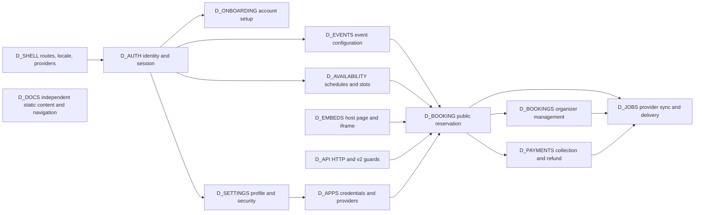

# Pinned product behavior contract

This reference binds Cal.flare to upstream Cal.diy `e8afecd163cd3a0a3ff279bd4721aa7f073c4685`.
All source links below address that public `calcom/cal.diy` commit, including original `apps/web` and `apps/api` paths.
The target retains the original folder structure and `app/`, `pages/`, and `next` imports under vinext with React `19.3.1`; [architecture](architecture.md) defines the implementation boundaries.
The source web manifest uses Next `16.4.3`, next-auth `4.24.15`, and React/React DOM `18.2.0`. These source versions are replay inputs, not evidence of target compatibility. [source manifest][sourceWebManifest]

## Meaning of 1:1

Identical initial state, configuration, actor, clock, provider responses, and input sequence produce identical observable UI, HTTP, DB, provider effects, and errors.
Initial state includes relation rows, feature grants, cookie and storage state, selected profile, calendar tokens, queued tasks, and provider resources.
Configuration includes unset values, literal flag strings, build-time values, locale, time zone, branding, app enablement, and community-edition stubs.
Actor includes anonymous booker, attendee, organizer, team member, owner, admin, system admin, OAuth client, provider callback, and scheduler.
A URL alone does not identify a behavior.

Observable equality covers these dimensions.

| Observation | Equality requirement |
| --- | --- |
| UI | Same components, markup, styles, copy, translation keys, loading and empty states, validation, keyboard actions, responsive layouts, themes, redirects, and user-visible ordering. |
| HTTP | Same path and method, status, body shape and values, headers, cookies and attributes, redirect location, parser behavior, error mapping, and API version selection. |
| DB | Same logical rows, field values, relations, null and missing values, status transitions, ordering, pagination, unique-conflict behavior, and rollback boundaries. Storage encoding follows the D1 contract in the plan. |
| Providers | Same requested calendar, video, payment, mail, CRM, and webhook operations, payloads, signing, recipient selection, suppression, and partial failures. |
| Time and retries | Same boundary comparisons, scheduled eligibility, attempt accounting, cancellation, expiry, and retry decisions. Provider latency and generated IDs require controlled inputs or explicitly matched semantic fields. |
| Errors | Same guard order where it changes disclosure or side effects. Same recoverable UI state, HTTP mapping, persisted partial work, and suppressed or propagated failure. |

Generated IDs may be compared through a consistent relation-preserving mapping when generation cannot be fixed.
This allowance does not cover public UID formats, iCal identity, response omission, changed ordering, or different provider calls.
A model pass, build, screenshot, or green retained suite alone does not establish 1:1.

## Whole system

[Source map](inventory/source-map.tsv) assigns every pinned source path its domain and destination.
[Routes](inventory/routes.tsv) binds entry points, including APIs and config-dependent paths.
[Integrations](inventory/integrations.tsv) binds individual providers.
[Manifests](inventory/manifests.tsv) binds package dependencies.
Those inventories account for files. The machines below account for interactions and observables.
An inventory row does not prove every branch of its file.

Arrows show shared contracts, not a universal execution order.
Independent domains have independent state. An accepted booking, failed provider event, and failed email can coexist.
Actual ordering belongs to the transition tables below.

| Domain | Actor and configuration boundary | State owned by domain |
| --- | --- | --- |
| `D_AUTH` | User, OAuth provider, email callback; identity provider, secret, secure URL, 2FA, rate limit, profile, admin requirements. | Authentication attempt, JWT, session projection, password reset, 2FA setup and codes. |
| `D_ONBOARDING` | Signup visitor, invited user, existing member; signup and verification flags, invite token, onboarding version. | User, verification token, memberships, completion and current step. |
| `D_BOOKING` | Booker, attendee, organizer; event, form, time, host selection, confirmation, seats, payment, dry run. | Request, booking lifecycle, reschedule link, seat and attendee, public response. |
| `D_AVAILABILITY` | Organizer, booker, provider; schedules, date overrides, limits, time zones, busy calendars, feature guards. | Schedules, available ranges, slots, reservations, exclusions and diagnostics. |
| `D_EVENTS` | Event owner, member, admin; ownership, scheduling type, parent event, feature grants and installed apps. | Event configuration, host groups, private links, location, form and limits. |
| `D_BOOKINGS` | Organizer, attendee, authorized manager; list filters, identity, status, date and access checks. | Listing projection and management commands into booking lifecycle. |
| `D_SETTINGS` | Signed-in user or authorized admin; current profile, identity provider, permissions, locale, flags. | Profile, password, security, developer credentials, preferences and account settings. |
| `D_APPS` | User, team admin, OAuth provider, video participant; registry, enabled app, keys, state, credential scope. | Installation, credentials, selected and destination calendars, meeting state, routing presentation. |
| `D_PAYMENTS` | Booker, supported payment provider, organizer; app credentials, price, currency, collection mode. | Payment request and receipt, booking paid state, refund or fee operation. |
| `D_JOBS` | Scheduler, task processor, provider notification, webhook receiver; runner choice, flags, due time, attempt limits. | Task, scheduled trigger, calendar subscription and cache, delivery outcome. |
| `D_API` | Public caller, session user, API key owner, OAuth client; allowed auth methods, version, roles, throttle config. | Parsed request, authentication context, response projection, cache and queue commands. |
| `D_EMBEDS` | Host page, iframe, React consumer; namespace, origin, layout, UI, prefill, modal lifecycle. | SDK command queue, iframe readiness, events, size and modal state. |
| `D_DOCS` | Reader; content path, metadata, navigation and theme. | Static documentation URL, MDX content, table of contents and links. |
| `D_SHELL` | Visitor, authenticated user; middleware, flags, locale, theme, asset and CSP configuration. | Route resolution, page wrappers, headers, cookies, shared navigation and translations. |

## Evidence and replay status

This specification records source inspection and bounded model execution.
It does not record a completed differential replay of the full product.
Inherited suites named below are existing pin evidence sources, not newly written port tests and not claims that those suites ran in this PR.
Suite presence does not establish an executed gate. This research ran no product suite or provider delivery.
PostgreSQL is the reference storage behavior only. The complete product database must migrate to D1 on Workers; external PostgreSQL and Node-hosted application services are forbidden target substitutes.

Differential replay acceptance is a chosen procedure for each implementation unit.
Both applications use isolated synthetic state and the same clock, config, actor, actions, and provider outcomes.
The reference must use this pin's original entry points and dependency graph. A selected-route build counts only for the routes and configurations it actually runs.
Auth, settings, admin, API, jobs, apps and other routes need their actual pinned entry points available before their replay can count.
That is an operational prerequisite, not permission to replace those routes with fixtures.

Each replay compares the relevant UI, response, DB relations, and provider or mail receiver records after every transition.
Failure injection occurs before and after each changed persistence or external boundary listed below.
The implementation PR retains commands, seed identity, config profile, normalized results, and direct operational observations in its ordinary verification evidence.
It uses inherited tests where those tests cover the transition. It creates no port-only test suite, deletion audit, or generated parity report.
Real provider delivery remains separate evidence when synthetic provider responses cannot establish it.

## D_AUTH

Pinned anchors are [credential and OAuth options][auth], [server session][session], [reset request][resetRequest], [reset endpoint][reset], and [2FA endpoints][totpSetup].
[Auth statechart](models/auth-session.mmd) shows separate login, 2FA setup, and reset machines.

| Transition and guard | Success, failure, retry and effects |
| --- | --- |
| Anonymous → credential check | `authorizeCredentials` rejects absent credentials, unknown user, locked account, rate limit, missing password hash, and wrong password in source order. Unknown user and wrong password use `incorrect-email-password`. Password verification also runs for OAuth identities that have a password. [151–187][auth] |
| Password verified → second factor or authenticated identity | Enabled 2FA chooses backup code first when supplied. A matching hyphen-stripped backup code becomes `null` in the encrypted list before login returns. Missing encryption key, missing codes, wrong backup code, missing TOTP, missing or malformed secret, and wrong TOTP retain distinct errors. No new transaction or simultaneous-code-use guarantee is inferred. [189–243][auth] |
| Authenticated admin → role projection | CAL admin without required password strength and 2FA becomes `INACTIVE_ADMIN`, with `password`, `2fa`, or `both`. Development and `NEXT_PUBLIC_IS_E2E` branches bypass this requirement. Other roles and non-CAL admins retain their role. [247–287][auth] |
| OAuth callback → existing, linked, invited, conflicting or new identity | Provider registration depends on configured Google or Outlook keys and enable flags. Email, name, known provider, verified identity claims, existing provider ID, legacy ID repair, changed email, invited account, and same-email identity have different branches. Azure accepts only the enumerated `xms_edov` true representations. CAL same-email linking rejects unverified local email. Existing 2FA redirects to signed `totp` login. The login view omits password input for `totpEmail`, while this credential verifier still requires a correct password. Preserve that source mismatch; no successful passwordless second-factor completion is established here. [login view][loginView] [316–357][authProviders], [788–1070][authOAuth] |
| JWT creation or update → session | Preserve custom `sub`, user ID, role, profile, `upId`, org, locale, impersonation and inactive-admin fields. Session metadata can override JWT max age in minutes. The email provider's actual `maxAge` expression is `10 * 60 * 60`; its comment says 10 minutes. Preserve the expression until an explicitly authorized product change. [359–441][authProviders], [528–786][authProjection] |
| Token → server session or null | Missing token, email, or `sub` returns null. The token-keyed LRU is checked before DB lookup. Numeric positive user ID, existing DB user, profile enrichment and impersonation resolve the server projection. Server helper does not refresh expiry. Its local license stub returns true; the auth session callback sets `hasValidLicense` false. Keep these caller-dependent projections. [11–151][session] |
| 2FA disabled → setup pending → enabled → disabled | Setup requires session, password conditions, key, and correct password. It writes encrypted 32-character secret and ten backup codes with `twoFactorEnabled=false`, then returns QR data and codes. Enable validates setup and TOTP before setting true. Disable has provider-dependent password checks, backup-or-TOTP validation, and clears all secret and backup fields. Already disabled returns success. [setup][totpSetup], [enable][totpEnable], [disable][totpDisable] |
| Reset requested → token valid → password changed → token expired | Reset lifetime is six hours. A new request expires existing live requests. Three requests within five minutes reject another request. Reset endpoint requires matching `calcom.csrf_token`, then deletes that cookie before rate limit or token lookup. It validates password, finds an unexpired request, upserts password, verifies email, resets identity to CAL, then expires the request. User update failure returns `{}` with 404. Token expiry is a separate write. [6–64][resetRequest], [16–104][reset] |

Invariants preserve guard order, encrypted data format, public error strings, session caller shape, and code consumption side effects.
They do not promise global session revocation on password change, atomic reset-token consumption, or concurrent backup-code exclusion.
Those promises are absent from the inspected paths.

Differential replay acceptance covers password success and each credential rejection, backup-code reuse, TOTP success and failure, enabled and missing provider config, each OAuth account-link branch, both session projections, expiry, profile update, admin downgrade, reset supersession, CSRF retry, and failed token-expiry write.
Existing suites include [2FA login][test2fa], [forgot password][testReset], `packages/features/auth/lib/next-auth-options.test.ts`, and `getServerSession.test.ts` at the pin.

Remaining source-level branch obligations are the email-provider adapter token lifecycle in `next-auth-custom-adapter.ts`, new-user and account-link effects in `next-auth-options.ts:1070–1235`, Google and Microsoft credential auto-install in `:565–728`, cookie attributes in `packages/lib/default-cookies.ts`, and the route-specific auth/error mappings.
Their branch inputs are provider type, invite status, verified identity, scopes, missing app, secret availability, HTTPS, redirect target, and expired or consumed token.
Each moved caller retains its own session projection rather than assuming both helpers are identical.

## D_ONBOARDING

Pinned anchors are [signup dispatch][signup], [self-hosted signup][signupSelf], [onboarding redirect][onboarding], [classic steps][onboardingSteps], and [email verification][verifyEmail].

| Transition and guard | Success, failure, retry and effects |
| --- | --- |
| Signup form → guarded request | Rate limit and Turnstile precede signup handling. Env `NEXT_PUBLIC_DISABLE_SIGNUP` or global `disable-signup` rejects with 403, except a supplied invite token bypasses that enablement check. Middleware has a separate disabled-signup 503 branch. Premium-username flag chooses a different handler. [18–79][signup], [73–80][proxy] |
| Valid signup → account and membership or conflict | Self-hosted handler validates username and email, corrects invite namespace, checks reserved and existing usernames, hashes password, creates or upserts the invited user, writes memberships, and consumes invite token. Conflicts keep 409 or 422 responses. Ordinary signup sends verification and returns 201 `Created user`. The write sequence is not one inferred all-effects transaction. [26–195][signupSelf] |
| Verification requested → skipped, blocked or sent | Global `email-verification` off and platform users skip link verification. Watchlist can block. Link tokens expire after one day and create before mail sends. Code verification is a separate path. [32–123][verifyEmail] |
| Session user → verify-email, classic onboarding, v3 onboarding or application | Only incomplete, non-org users created after the introduction date enter this redirect path. With email check requested, CAL and verification-enabled users without verified email go to `/auth/verify-email`. `onboarding-v3` and any membership select `/onboarding/personal/settings`, `/onboarding/getting-started`, or `/getting-started`. [19–76][onboarding] |
| Classic step → next | Exact order is `user-settings`, `connected-calendar`, `connected-video`, `setup-availability`, `user-profile`. Invalid step falls back. User settings save name/timezone before next; availability creates or updates default schedule before next. V3 organization submission has a community stub for org intent. Do not imply a working hosted organization checkout. [28–146][onboardingSteps], [1–148][onboardingSubmit] |
| Complete classic/v3 personal onboarding → application | Classic saves bio and `completedOnboarding=true`, attempts default event creation when none exist using mutation callbacks, refetches user, consumes localStorage `onBoardingRedirect`, then navigates there or `/`. V3 saves completion, awaits default event mutations for `15min`, `30min`, hidden `secret` when none exist, catches creation errors, refetches user, consumes redirect if present, otherwise selects `/event-types?welcomeToCalcomModal=true` or `/event-types?newOrganizationModal=true` using sessionStorage `showNewOrgModal`. Success does not imply all default-event writes succeeded. [classic completion][classicCompletion], [v3 completion][personalCompletion] |

Invariants retain invite consumption, namespace and uniqueness handling, verification skips, component-owned completion, and redirect destinations.
Retry after account creation or failed mail can see existing rows; success response does not imply mail delivery.

Differential replay acceptance covers ordinary and invited signup, duplicate username or email, disabled signup at middleware and route, Turnstile failure, verification off and on, invalid and expired tokens, existing user and org, classic and v3 flags, skip/back/reload, calendar connection error, schedule save, and final persisted completion plus redirect.
Existing [onboarding suite][testOnboarding] covers CAL and Google users; signup handler suites cover dispatch outcomes.

Remaining branch obligations are `calcomSignupHandler.ts` when `IS_PREMIUM_USERNAME_ENABLED`, invite helpers under `packages/features/auth/signup`, verification callback handlers, and every classic/v3 step component reached from the inventory.
Required branch inputs are existing invite, team parent, verified email, preexisting account, selected plan, migration selection, and failed step save.
Neither naming a step nor completing its screenshot closes those state changes.

## D_BOOKING

Pinned anchors are [Booker states][bookerTypes], [booking service][regular], [confirmation rules][confirmationFlags], [booking persistence][createBooking], [manual confirmation][confirm], [confirmation effects][handleConfirm], [cancellation][cancel], and [seat writes][seats].
The [booking flow](models/booking-flow.mmd) summarizes the lifecycle.
[Checked models](models/README.md) cover restricted status transitions and one remaining seat under contention.

| Transition and guard | Success, failure, retry and effects |
| --- | --- |
| Loading → selecting date → selecting time → booking | Preserve `loading`, `selecting_date`, `selecting_time`, `booking`, layout and URL-driven state, selected time zone, duration, form responses, hashed link, reschedule data and back navigation. These UI states do not imply DB state. [104–105][bookerTypes], [302–708][bookerStore] |
| Submit → validation and host selection | Event ID or dynamic slug selects event and system booking fields. Booker block checks, active-booking limits, email code verification, event length, temporal bounds, reschedule restrictions, host loading, booking/duration limits, collective and round-robin selection precede persistence. Missing or unavailable hosts and invalid lengths retain source errors. Dry-run path produces synthetic booking and troubleshooter data rather than committing ordinary booking effects. [435–1158][regular], [15–31][validateLength], [24–63][validateTime] |
| Valid request → existing booking or new row | Pending/round-robin duplicate lookup may return the existing attendee/time booking. Payment response depends on existing payment rows and paid flag; it is not a universal idempotency rule. Unique collision maps `P2002` cause to 409 `BookingConflict`. [677–725][regularDedup], [1818–1827][regularPersist] |
| New row → accepted or pending | Default confirmation is `(!requiresConfirmation && price === 0) \|\| userReschedulingIsOwner`. Free-email rule can replace confirmation choice; threshold clears it only when time difference is greater. Initial DB status follows this flag. Calendar work follows the DB write only for default-accepted bookings. All provider results may fail while row remains and guarded confirmation notifications are still attempted. [13–93][confirmationFlags], [183–220][createBooking], [2050–2184][regularProvider] |
| Pending → manually accepted or rejected | Booking-access check precedes already-accepted error. When a payment row exists and booking is unpaid, manual confirmation writes `ACCEPTED` and returns immediately, despite the opposite wording in its comment. Otherwise provider creation and guarded confirmation notifications precede accepted DB write. All failed provider results are logged and attached as `evt.appsStatus`; mail failure is caught and confirmation still proceeds. Rejection can refund before writing `REJECTED`, then send declined notifications and webhook. Do not add a universal pending-only guard absent from this handler. [161–197][confirm], [76–122][handleConfirm], [167–261][handleConfirmWrites], [413–479][confirmReject] |
| Returned create results → confirmed notifications | Nonempty all-failed results still reach guarded dispatch. Default-accepted fresh booking retains `!noEmail`, `!isDryRun`, and `!(seatsPerTimeSlot && rescheduleUid)` guards. Confirmation helper retains `emailsEnabled`. Both retain event metadata's host/attendee confirmation and all-email suppression through the mail manager. All-failed branches leave additional-information metadata empty and attach failure status before dispatch. A thrown create call can still abort before dispatch; attempted mail does not prove delivery. [fresh create][regularProvider], [confirmation helper][handleConfirm], [confirmed handler][confirmedMail], [recipient guards][scheduledMail] |
| Provider results → app status and organizer warning block | Without `reqAppsStatus`, map each result to success/failure counts, errors and optional warnings; also assign `booking.appsStatus` when a booking is supplied. With prior status, aggregate by integration `type`, adding both success and failure counts and concatenating errors. Preserve the optional `warnings?.concat(...)` expression and mutation of accumulated entries. Confirmation's all-failed path passes no booking or prior status. Organizer HTML renders these counts, errors and warnings. [status aggregation][appsStatus], [organizer template][organizerScheduled], [shared template][scheduledTemplate], [status rendering][appsStatusEmail] |
| Accepted/pending → payment required | Positive price and unpaid original select payment initiation after booking persistence and booking events. Missing credential, null unsupported payment service, and failed initiation are different branches. Payment path returns before later ordinary webhook/reference processing. Paid original reschedule carries paid state and successful payment relation. [2186–2363][regularPayment], [122–147][createBooking], [52–74][handlePayment] |
| Reschedule → replacement or seated move/merge | Non-seat path cancels the original and creates replacement in one Prisma interactive transaction. It sets `rescheduled`, `fromReschedule`, paid inheritance, recurrence link, and iCal sequence. Provider update happens later. Owner, attendee, original cancelled state, changed organizer, moved host, and minimum reschedule notice select different paths. Source cancellation guard prevents a later cancel of an unchanged cancelled original from deleting the reused provider event. [139–147][createBooking], [228–263][createBookingReschedule], [435–483][regular], [1831–2047][regularReschedule], [129–139][cancel] |
| Cancel request → seat removal or cancelled booking | Reject missing booking, already cancelled, missing owner, disabled cancellation, required reason, ended event, and unauthorized whole seated booking. Seat-specific path returns `onlyRemovedAttendee=true` when applicable. Ordinary path attempts cancellation webhook before DB cancellation, then handles refund/hold fee, provider cleanup, deleted reference flags, scheduled trigger/no-show cancellation, and email. Those later failures can be logged while success returns. [108–188][cancel], [308–524][cancelEffects] |
| Join existing seated slot → attendee plus seat | `addSeatToBooking` locks Booking `FOR UPDATE`, rereads count of attendees with `bookingSeat`, rejects full positive capacity, and creates attendee and seat in one transaction. Capacity zero bypasses its limit. Cancelled stored booking can be accepted in this helper. Provider updates and mail follow the seat commit. The port must preserve this actual atomic boundary on D1; broad claims that the pin has no seat race protection are wrong. [41–114][seats], [159–295][seatsEffects] |
| Remove or reschedule seat → keep, move, merge or cancel | More than one attendee plus valid seat selects attendee-only deletion and provider update; unknown seat returns 400. Last attendee falls through whole-booking cancellation. Seated reschedule distinguishes owner whole-event move/merge and attendee move to an existing/new slot. Preserve seat reference UID, seat-local responses and description, capacity, payment relation and notifications. [42–186][cancelSeat], [13–136][handleSeats], [owner machine][ownerSeats] |

Invariants preserve status strings, linked replacement identity, iCal identity and sequence, capacity at the protected add-seat boundary, response redaction, and guard-relative effects.
An accepted row does not prove provider success, paid state, email, or successful webhook.
Reference persistence failures after creation are caught. Requested webhook queueing happens after that attempted update and has its own catch. [2447–2487][regularTail]
No DB-level exclusion for all distinct overlapping non-seat bookings follows from these functions.

Differential replay acceptance includes free, approval, payment, approval plus payment, host reschedule, attendee reschedule, all-provider failure, one-provider failure, no provider, duplicate submission and unique conflict, dynamic group, collective and round-robin unavailability, custom fields, guests, email verification and spam decisions, dry run, cancellation reason, ended event, recurring scope, and each seat move/merge/full/last-attendee case.
For fresh creation and later confirmation, compare notification attempts after all-failed, partial and empty results; thrown create, `noEmail`/`emailsEnabled`, host/attendee suppression, mail failure, and recurring status aggregation. Compare organizer warning blocks and recipient records separately from DB acceptance.
Compare original and replacement rows, attendees, seats, references, payment ownership, status, public body, iCal fields and ordered provider effects after every request.
Inject failure inside each transaction and between DB/provider/mail/webhook steps.
Existing suites live under `packages/features/bookings/lib/handleNewBooking/test/`, `handleCancelBooking/test/`, `handleSeats/test/`, `handleSeats/create/createNewSeat.integration-test.ts`, and [booking confirm/reject][testConfirm] at the pin.
Inherited [fresh-booking failure assertions][testFreshFailure] and [pending-confirmation helper case][testConfirmFailure] check confirmation emails and app status; [status aggregation cases][testAppsStatus] check accumulated failures. These are inspected assertions, not executed product proof. Separate broken-integration notices remain commented out in the fresh-booking case.

Remaining branch obligations are concrete families, not a happy-path completion claim.
`RegularBookingService.ts:791–1158` binds fallback/fixed/weighted round-robin selection and assignment reasons.
`:1158–1494` binds guest/secondary email, language, team destination calendars, booking fields and spam outcome.
`:1831–2047` binds changed-organizer cleanup and recurring/provider reschedule.
`:2365–2565` binds nonpayment reference writes, scheduled events, requested webhook, no-show, analytics and notification suppression.
`RecurringBookingService.ts`, `getBookingData.ts`, `originalRescheduledBookingUtils.ts`, `handleSeats/reschedule/**`, and cancellation metadata validators bind their own error and rollback branches.
Each changed branch needs either an inherited assertion or direct synthetic replay of its real entry point, including a failing input and its persisted partial state.

## D_AVAILABILITY

Pinned anchors are [availability computation][availability], [slot computation][slots], [schedule creation][scheduleCreate], and [schedule update][scheduleUpdate].

| Transition and guard | Success, failure, retry and effects |
| --- | --- |
| Organizer → schedule created | Owner check applies when event ID supplied. Weekly hours use submitted schedule or default, time zone comes from user, and first schedule becomes default through a later user update. [19–76][scheduleCreate] |
| Edit/default selection → schedule saved or denied | Missing schedule or no edit access returns 401. Default selection can write first. Missing name returns early to avoid erasing availability. Normal save deletes old availability and creates new weekly/date rows in nested write. Preserve submitted date and `days` representation, returned default IDs and fallback time zone. [48–165][scheduleUpdate] |
| Availability request → selected schedule and busy ranges | Resolve schedule/event/user fallback, current seats, delegated timezone, travel, OOO, holidays and team/user limits. Missing user is 404; missing availability is 400. Busy-provider exception returns an empty availability result including empty working hours, not unrestricted availability. [361–648][availability] |
| Ranges → slots or empty/error | Date validation, notice, bounds, buffers, interval/duration, OOO, host groups, busy reservations, limits, current seats and dynamic event rules determine slots. All blocked hosts produce empty slots. Restriction-schedule feature method currently returns false and org blocking resolver returns null. Keep those community branches rather than enabling unreachable logic. [672–678][slotsNotice], [845–1118][slotsBranches] |

Invariants retain time-zone/DST arithmetic, exclusive/inclusive comparisons from source, ordering, labels and busy-source diagnostics.
The supported zone list includes `America/Coyhaique`. Its inherited test checks Intl acceptance and different July 2026 hours from `America/Santiago`; target Intl/tzdata needs actual replay, not a Santiago substitution. [zone entry][timeZones], [inherited checks][testTimeZones]
An offered slot is a read result, not a transactional booking guarantee.
`getCalendar` enables cache only in `slots` mode, for a supported calendar type, with both global and nonhierarchical user grants. `booking`, `overlay`, and `none` use the original provider service. The wrapper then partitions cached/live selected calendars. [48–121][getCalendar]

Differential replay acceptance covers first/default/deleted schedule, edit denied, name-only/default-only update, absent schedule, weekly and date override, positive/negative UTC offsets, DST gap/fold, travel, OOO and holiday, booking/duration/team limits, before/after buffers, different intervals, stale reservations, full/partial seats, dynamic groups, and provider exception.
Existing suites include [availability browser cases][testAvailability], `packages/features/schedules/lib/slots.test.ts`, `date-ranges.test.ts`, `useTimesForSchedule.timezone.test.ts`, and availability/slot suites in the source map.

Remaining branch obligations are `slots/util.ts:146–288` reservation cleanup and out-of-range filtering, `:379–650` limits, `:678–845` host computation, `:1118–1435` slot formatting and quick availability, `detectEventTypeScheduleForUser.ts`, and schedule delete/duplicate/default handlers.
The replay records schedule precedence, source mode, cache state and exact clock boundaries for those functions.

## D_EVENTS

Pinned anchors are [event creation][eventCreate] and [event update][eventUpdate].

| Transition and guard | Success, failure, retry and effects |
| --- | --- |
| Listing → new event | Use actual page procedure, group/filter ordering, user/team context and defaults. Create selects default locations and video config, handles team/scheduling type, and maps duplicate slug to `BAD_REQUEST`. Permission-check service in this file is a community stub that returns true. Other explicit guards still run. [13–18][eventCreate], [45–167][eventCreate] |
| Editor → updated event | Preserve team consistency, seat/recurrence incompatibility, ascending limits, positive booker limit, nonnegative offset, booker layout validation, owned schedule assignment and restriction schedule checks. Update changes destination calendars, custom questions, host groups, accepted team hosts, private links, verified secondary email, video settings and event row in source order. [179–460][eventUpdate], [586–775][eventUpdateTail] |
| Managed event → child handling | Parent/child IDs and booking behavior remain distinct. `updateChildrenEventTypes` in this pin is a no-op. A comment or inherited domain guide describing propagation does not authorize adding it. Booking rejects or selects managed shapes through its real pinned booking source. [31][eventUpdate], [managed booking suite][testManaged] |
| Save/delete → refreshed view or failure | Preserve relation cleanup and source error mapping. `P2002` on update maps `error_event_type_url_duplicate`; revalidation can follow saved event. Earlier side writes are not automatically rolled back by failure of the final update. [702–775][eventUpdateTail] |

Invariants retain IDs, slugs, ownership, enabled/hidden state, parent relations, question keys, app metadata, host priority/weight, and disabled controls.
Retry observes previously saved side writes; UI success requires the owning mutation response.

Differential replay acceptance covers personal/team/managed/dynamic event, duplicate slug, create defaults, all editor tabs, add/reorder/remove questions, seats versus recurrence, invalid limits/layout, unauthorized schedule, host group edits, private links, secondary email, installed payment/video app, and failed nested or final write.
Existing [event types browser suite][testEvents], `eventType/availability-tab.e2e.ts`, `eventType/limit-tab.e2e.ts`, and handler suites remain source evidence.

Remaining branch obligations are create/update input schemas, listing group filters, `eventTypes/util.ts` middleware, delete/duplicate/assignment procedures, `heavy/update.handler.ts:403–585` host-group and per-host location transactions, and metadata-to-app transforms.
Their source predicates need positive/negative rows for owner, accepted member, parent event, app enabled state, and omitted/null/empty values.

## D_BOOKINGS

Pinned anchors are [listing query][bookingList], [status partition][bookingStatuses], [manual actions][confirm], and [cancellation][cancel].

| Transition and guard | Success, failure, retry and effects |
| --- | --- |
| Session and filters → list projection | Cursor parses as nonnegative offset; statuses list overrides single status, then default applies. Preserve total, recurring projection, ownership/attendee/team union, deduplication, typed filters, selected columns and enrichment. Invalid cross-user filter rejects. [40–91][bookingList], [93–440][bookingListAccess] |
| Status tab → row selection | `cancelled` includes rejected. `unconfirmed` means pending with end at/after now. Upcoming, past and recurring use their own time/recurrence/status predicates. Default sort depends on one selected status; explicit sort precedence is start, end, created, updated. [1002–1051][bookingStatuses], [1128–1153][bookingSort] |
| Row action → command pending → refresh or error | Confirm, reject, reschedule, cancel, location change, no-show and logs use their actual access guards and return shapes. Confirm/reject and cancel do not share one universal authorization rule. Successful command feeds the `D_BOOKING` machine; list rendering is a separate read. [161–197][confirm], [108–188][cancel] |

Invariants retain row visibility, attendee/organizer identity, pagination totals and sort, recurrence grouping, payment/seat badges, and access-dependent actions.
A disappearing row only proves new query membership, not provider deletion.

Differential replay acceptance covers all status tabs with boundary-time rows, rejected rows, original/replacement, recurring series, seats, paid/unpaid, organizer/attendee/team visibility, outsider filters, empty list, pagination and every filter/sort operator, then all visible row actions.
Existing `packages/trpc/server/routers/viewer/bookings/get.handler.test.ts`, `get.handler.integration-test.ts`, and [confirm/reject browser suite][testConfirm] bind these behaviors.

Remaining branch obligations are listing union branches in `get.handler.ts:93–440`, attendee/profile enrichment in `:657–868`, raw team/event filters in `:877–999`, text operators in `:1071–1126`, `BookingAccessService.ts`, and each action procedure in the inventory.
SQL rewrites compare resulting row sets and relation projections with the pin, including nulls and case behavior.

## D_SETTINGS

Pinned anchors are [profile update][profile], [password change][changePassword], [API key creation][apiKeyCreate], and the `D_AUTH` 2FA endpoints.

| Transition and guard | Success, failure, retry and effects |
| --- | --- |
| Open settings → own/admin context | Preserve page-local auth, selected profile, role guard, navigation, feature-gated controls and community stub results. Admin route visibility does not imply every settings handler uses the same guard. |
| Edit profile → saved fields or validation | Profile update resolves username availability and org identity, booker layout, premium username conditions, email verification, travel rows and timezone/default schedule effects. Duplicate email maps 409 `email_already_used`. Omitted values, explicit nulls and unchanged values stay distinct. [46–125][profile], [213–310][profileWrites] |
| Change password → upsert or rejection | Non-CAL without password returns `THIRD_PARTY_IDENTITY_PROVIDER_ENABLED`; missing local password, incorrect old password, equal password, and weak password remain different errors. Hash/upsert follows checks. [19–74][changePassword] |
| Developer API key → one-time plaintext response | Team key creation requires admin/owner permission helper. Persist UUID and hashed key, selected expiry or null for never-expires; return configured prefix plus plaintext key. List/revoke and webhook/OAuth settings keep their own guards. [18–45][apiKeyCreate] |

Invariants retain private credential redaction, persisted hashes, field validation and localization, user/team ownership, email verification and resulting session refresh semantics.
No global all-settings transaction or extra session invalidation follows from these handlers.

Differential replay acceptance covers profile username/email conflicts, timezone with and without schedules, locale/theme/time format, avatar upload and failure, change password for CAL/OAuth with/without password, TOTP enable/disable, API key expiry and team denial, revoke, developer webhook edits, OAuth-client permissions and each in-scope admin action.
Existing [settings admin route suite][testSettings], `settings/upload-avatar.e2e.ts`, auth browser suites, and relevant tRPC handler suites are reused where applicable.

Remaining branch obligations are `updateProfile.handler.ts:125–212,283–421`, per-page settings/admin guards, API-key `_auth-middleware.ts`, developer webhook/OAuth-client handlers and account deletion.
Deletion replay uses disposable synthetic account state only. It does not authorize touching private accounts or stored production credentials.

## D_APPS

Pinned anchors are [OAuth state][oauthState], [credential creation][credentialCreate], [credential deletion][credentialDelete], [EventManager][eventManager], [Google auth][googleAuth], and [routing presentation][routerPage].
Provider rows in the integration inventory are separate acceptance units, including disabled or unavailable providers.

| Transition and guard | Success, failure, retry and effects |
| --- | --- |
| Catalog → enabled/configured app → installation | Registry metadata, DB app enablement, required keys, categories, installed credentials and user/team context control visible cards and entry points. Importable provider code alone does not mean configured service. App metadata cron defaults to dry run unless `CRON_ENABLE_APP_SYNC === "true"`. [11–79][appSync] |
| Install → redirect → callback → credential | OAuth state is parsed JSON and normally validates nonce/HMAC against session user and `NEXTAUTH_SECRET`. Specific exempt app slugs bypass that check. Missing or bad state returns undefined in decoder; callers own the next response. Credential creation requires session and checks team admin when team ID is in valid state. Preserve provider callback-specific token/credential error and redirect. [6–35][oauthState], [18–54][credentialCreate] |
| Calendar connected → selected/destination → invalid/disconnected | Selected calendars drive busy reads; destination calendars drive writes. Refresh and delegation paths differ. Google invalid grant can invalidate credential and throw; successful refresh writes token object and updates cached credential. Deletion cleanup and replacement destination selection follow actual credential handler. [205–308][googleAuth], [credential cleanup][credentialDelete] |
| Booking → conferencing/calendar/CRM operation | EventManager can fall back to Cal Video when configured, routes Meet through Google Calendar, and handles Teams-with-Outlook specially. Dedicated meeting creation can precede calendar work; other-calendar/CRM operations are separate. Delete runs all integration removals with `allSettled` and soft failures. [287–362][eventManager], [777–850][eventManagerDelete] |
| Video URL → join, not started, ended or missing | Preserve actual room/booking/token guards, identity, room settings, join UI, recording controls and community restrictions from video route and view sources. Provider errors do not become a fabricated room. [video view][videoView] |
| Routing URL → message/error presentation | Pinned Pages route renders sanitized `message \|\| errorMessage` inside Cal.diy Forms; embed route reexports it. It does not itself implement routing-form evaluation. Preserve separately inventoried routing integrations as actually reachable. [1–39][routerPage] |

Invariants retain credential owner/team, selected versus destination calendar, provider IDs, scopes, token expiry units, encryption, callback state exceptions and user-visible failures.
Daily and Shimmer video adapters reject missing booking UID with `We need the booking uid to create the Daily reference in DB`; callers retain their own failure mapping. [Daily guard][dailyUid], [Shimmer guard][shimmerUid]
Retry follows provider-specific code. No universal OAuth retry, revoke success, or provider exactly-once guarantee is inferred.

Differential replay acceptance covers no-key app, disabled/invalid-key app, install/remove, own/team/outsider context, cancelled callback, malformed state, exempt and ordinary state, expired/invalid refresh, destination fallback, Google Meet with and without destination, Teams with Outlook, Cal Video lifecycle, partial provider failure, disconnect with affected event types, and routing message/error sanitization.
Existing app/conferencing browser suites, `handleDeleteCredential.integration-test.ts`, `googlecalendar/lib/__tests__/CalendarService.test.ts`, `CalendarAuth` callers and video premium-feature suites supply inherited cases.
Local synthetic records cover payloads and failures. Successful real calendar invitation, inbox delivery and video join remain provider-specific operational evidence.

Remaining branch obligations are every integration inventory row's install/callback/service/webhook/config branch, `EventManager.ts:873–1351` destination/delegation/CRM paths, credential deletion `:1–510`, provider-specific refresh/revoke, video route server guards, and `api/integrations/[...args].ts` dispatch.
An integration marked waiting for provider credentials is not a completed provider-delivery claim.

## D_PAYMENTS

Pinned anchors are [payment initiation][handlePayment], [shared receipt handler][paymentSuccess], [refund][refund], [BTCPay webhook][btcpay], [PayPal webhook][paypal], [Alby webhook][alby], and [Stripe community endpoint][stripeStub].

| Transition and guard | Success, failure, retry and effects |
| --- | --- |
| Positive event/form price → payment initiation | Provider service comes from the generated map and app metadata. Dry run returns null. Unsupported or malformed service returns null with warning. `ON_BOOKING` and `HOLD` choose different provider operations. Form number/boolean/options pricing and locale formatting affect amount; addons convert to smallest currency unit. [52–190][handlePayment] |
| Supported webhook → ignored, rejected or verified receipt | Alby checks raw body/header/payload, app marker, invoice and amount; PayPal verifies webhook and handles approved order; BTCPay checks supported invoice events, payment and credential, duplicate-success early return, store and HMAC signature. Do not give all providers identical response codes or duplicate behavior. [Alby][alby], [PayPal][paypal], [BTCPay][btcpay] |
| Receipt → paid flag plus payment success → request or confirmation | Shared handler cancels awaiting-payment email best effort. Already-confirmed booking can create provider event before the payment DB transaction. Payment success and booking paid update commit together in array transaction. Confirmation requirement can preserve current status; pending unconfirmed receipt then requests approval or calls confirmation. `BOOKING_PAID` delivery is separate and failures are caught. Handler ends by throwing an HTTP-200 control exception, even when approval remains. [35–217][paymentSuccess] |
| Stripe webhook request → community response | `/api/integrations/stripepayment/webhook` returns 404 `Payment webhooks are not available in community edition`. `/api/stripe/webhook` returns 404 `Billing webhooks are not available in community edition`. No Stripe booking fulfillment is claimed for those pinned routes. Premium-user `paymentCallback.ts` is a different flow. [1–11][stripeStub], [1–11][billingStub], [25–146][premiumCallback] |
| Cancel/reject → refund or hold fee | Booking cancellation status can commit before refund/fee errors are caught. Rejection refund ordering differs. Refund helper visits every successful, not-yet-refunded payment, applies policy and calendar/business-day deadline, attempts each refund independently, then aggregates failures. Preserve payment-option decision, provider-specific refund, fee eligibility, success flags and error propagation at each caller. [409–425][cancelEffects], [413–430][confirmReject], [refund service][refund] |

Invariants retain amount, currency, collection mode, signature/raw-body semantics, booking/payment relation, paid flags, and provider-specific duplicate guards.
Payment receipt is not atomic with provider creation, mail, or webhooks.
Shared success handler does not provide universal duplicate-callback exclusion or cancellation rejection; callers differ.

Differential replay acceptance covers every configured payment app with exact raw request and signature, wrong amount/store/signature, unknown or duplicate payment, provider timeout, invalid credentials, HOLD/ON_BOOKING, priced form addons, payment plus approval, approval before payment, paid reschedule, rejection/refund failure and cancellation/fee boundary.
Stripe stub responses are positive parity cases.
Existing [payment UI suite][testPayments], `packages/app-store/_utils/payments/handlePaymentSuccess.test.ts`, and refund/no-show fee suites remain evidence sources.

Remaining branch obligations are payment-service maps and each mapped provider method, `handlePayment.ts:79–end` price and collection branches, each webhook's parser/status branches, `processNoShowFeeOnCancellation.ts`, `shouldChargeNoShowCancellationFee.ts`, and premium callback identity/verification behavior.
Real charge/refund acceptance needs disposable provider sandbox resources and provider credentials outside this documentation change.

## D_JOBS

Pinned anchors are [Task repository][taskRepo], [Task processor][taskProcessor], [task registry][taskRegistry], [webhook HTTP send][sendPayload], [internal send task][sendWebhookTask], [Trigger policy][triggerPolicy], [calendar cache wrapper][calendarCache], [subscription rollout][calendarSubs], and [calendar sync][calendarSync].
[Provider chart](models/calendar-provider.mmd) and [checked task chart](models/task-delivery/chart.mmd) describe separate machines.
The internal factory always returns `InternalTasker`; its RedisTasker implementation is unfinished and not selected. [factory][taskFactory]
The registry contains `sendWebhook`, `triggerHostNoShowWebhook`, `triggerGuestNoShowWebhook`, `sendSms`, `translateEventTypeData`, `createCRMEvent`, `sendAnalyticsEvent`, `sendAwaitingPaymentEmail`, `bookingAudit`, and `webhookDelivery`.
`sendSms` currently rejects with `Not implemented`. [9–25][taskRegistry]

| Transition and guard | Success, failure, retry and effects |
| --- | --- |
| Task created → due batch → handler | DB eligibility requires `succeededAt=null`, `scheduledAt < now`, and `attempts < maxAttempts`; batch orders by schedule and takes 1000. Processor starts tasks concurrently. No claim or lease is established by these reads. Unknown handler/import failures differ from a returned handler rejection. [21–74][taskRepo], [10–40][taskProcessor] |
| Handler resolves/rejects → completed/retry/exhausted | Resolve calls `succeed`, incrementing attempts and setting `succeededAt`. Rejection calls `retry`, incrementing attempts, recording error/time, and advancing schedule only for configured minimum interval. Max-attempt equality defines failed rows. Cleanup body is commented out. Cancellation deletes task or reference/type match; missing reference returns null. [110–212][taskRepo] |
| Webhook queued or direct → HTTP outcome | `TASKER_ENABLE_WEBHOOKS === "1"` selects scheduling. Signed POST uses HMAC-SHA256 or `no-secret-provided`, webhook version, source payload/template content type and manual redirect. Low-level HTTP non-2xx returns `{ok,status}`. Internal `sendWebhook` awaits it without inspecting `ok`, so a resolved 500 is completion for that path. Other consumer/service paths may log failure and still resolve. [6–9][sendOrSchedule], [296–326][sendPayload], [20–29][sendWebhookTask], [135–205][webhookService] |
| Trigger/sync tasker → dispatch/fallback, then delivery outcome | Base tasker chooses async only with `ENABLE_ASYNC_TASKER`, `TRIGGER_SECRET_KEY`, and `TRIGGER_API_URL`. Missing config uses sync. Async dispatch failure tries sync; sync failure propagates. This is separate from the internal DB tasker. [9–83][baseTasker] Trigger config has max three attempts, factor two, randomized 30s–600s interval, concurrency 25 and OOM machine switch. Task rethrows consumer exceptions. Internal webhookDelivery config instead uses three attempts and production five-minute/development one-minute retry interval. Preserve per-runner policy; a queue replacement cannot silently add stronger delivery promises. [5–23][triggerPolicy], [30–50][triggerTask], [27–36][taskRegistry] |
| Selected calendar → subscribed → cached/live → synchronized | Cache and sync have separate global/user/team feature inputs. Wrapper partitions selected calendars by both `syncToken` and `syncSubscribedAt`; cache-backed and live results merge. Subscribe rollout batches 100 with `allSettled`. Incoming Cal-managed events can drive booking cancel/reschedule through shared services. Missing credential or unsupported provider is a real state. [55–132][calendarCache], [400–453][calendarSubs], [41–230][calendarSync] |
| Cron trigger → authorized work/no-op/error | Subscription routes accept configured API key or `Bearer CRON_SECRET`, preserve 403 and response spelling. Disabled cache+sync returns `{ok:true}`. Reminder/webhook-trigger routes use their own API-key check and 401. App metadata sync defaults dry-run. The scheduled Worker entry must retain each job's selection window, due comparison and payload; internal invocation does not make public cron route behavior irrelevant. [24–70][cronSubs], [16–39][cronCleanup], [8–20][cronWebhooks], [16–157][cronReminder], [11–79][appSync] |

The source manifest uses `@trigger.dev/sdk` and `trigger.dev` `4.5.4`. The table records configured options, not observed SDK scheduling, retry, jitter or fallback execution. Those require replay with the pin's actual runner/dependencies; the internal task model does not exercise Trigger. [source job dependencies][sourceJobManifest]

The stored handlers retain distinct success and suppression rules.

| Stored handler | Pinned transition/effect and failed branch |
| --- | --- |
| `sendWebhook` | Parse task JSON/schema, POST signed payload, propagate parsing/transport rejection. Resolved non-2xx is not thrown by this handler. [20–29][sendWebhookTask] |
| `triggerHostNoShowWebhook` | Prepare eligible no-show state, update organizer or host-attendee flags, send one host-specific webhook per missing host. Host marking can log and return null while webhook path continues. [host no-show][hostNoShow] |
| `triggerGuestNoShowWebhook` | Prepare eligible state. Required-email mode identifies absent guests individually; other mode checks whether any guest joined. Attendee flag update and guest-filtered webhook data follow those branches. [guest no-show][guestNoShow] |
| `sendSms` | Registry returns a rejected promise with `Not implemented`; processor records retry rather than successful SMS delivery. [15][taskRegistry] |
| `translateEventTypeData` | Parse event/user/locale/title/description input, translate applicable fields, upsert title or description translations, log failed locales. Translation provider and partial-locale errors remain service-specific. [translation task][translationTask] |
| `createCRMEvent` | Parse payload, require booking/user and metadata, skip non-accepted booking, select enabled CRM apps/credentials, skip existing reference per credential, call CRM, store references. Retryable collected errors rethrow; invalid payload/missing booking/metadata and final writes can also fail. [CRM task][crmTask] |
| `sendAnalyticsEvent` | Parse credential/info, load credential, construct analytics manager, send event. Invalid payload/credential and send error log and rethrow. [analytics task][analyticsTask] |
| `sendAwaitingPaymentEmail` | Load booking/payment, skip missing payment or already successful/paid state, optionally filter to seat attendee, skip absent target attendee, send awaiting-payment template with payment data. Failure logs and rethrows. [awaiting-payment task][awaitingPaymentTask] |
| `bookingAudit` | Require task ID, parse/schema-check payload, dispatch bulk or single audit consumer, rethrow failed consumer. No audit persistence guarantee follows from the wrapper alone. [audit task][auditTask] |
| `webhookDelivery` | Require task ID, parse versioned payload and delegate to webhook consumer. Failure rethrows into configured task retry. [21–37][deliveryTask] |

The pinned `vercel.json` declares these schedules. [cron declarations][vercelCrons]

| Declared target | Cron expression | Source-bound outcome |
| --- | --- | --- |
| `/api/cron/calendar-subscriptions` | `*/5 * * * *` | Subscribe rollout behind cache/sync flags and endpoint auth. |
| `/api/cron/calendar-subscriptions-cleanup` | `0 3 * * *` | Clean stale cache behind endpoint auth. |
| `/api/cron/queuedFormResponseCleanup` | `0 */12 * * *` | No matching pinned route file. Preserve unresolved-target behavior; do not invent queued-form cleanup from declaration alone. |
| `/api/tasks/cron` | `* * * * *` | Web route exposes GET only, delegating to tasker handler requiring `Bearer CRON_SECRET`, returning 401 or `{success:true}`. Package also exports POST, which that web route does not export. [web route][taskCronRoute], [handler][taskCron] |
| `/api/tasks/cleanup` | `0 0 * * *` | Same bearer guard, delegates cleanup. Internal repository cleanup currently writes nothing. [web route][taskCleanupRoute], [handler][taskCleanup] |
| `/api/cron/credentials` | `*/5 * * * *` | No matching pinned route file. Do not add credential cleanup from declaration alone. |
| `/api/cron/selected-calendars` | `*/5 * * * *` | Delegation/calendar reconciliation with API key or bearer guard, 401 on failure, per-credential outcomes. [selected calendars][cronSelected] |

The pin also retains `bookingReminder`, `webhookTriggers`, `changeTimeZone`, and `syncAppMeta` cron handlers without schedules in that file.
Their endpoint behavior remains in scope; a scheduler declaration must not be assumed from their names.
Timezone handler updates user/default schedule state using travel dates and offset boundaries, then removes old travel rows. [timezone cron][cronTimezone]
The two declared missing targets remain exact route-replay obligations. Source absence alone does not measure their HTTP response after routing and rewrites.

Invariants retain payload, reference/type uniqueness, attempt increments, eligibility, due ordering, configured delay, suppression and cancellation state.
No exactly-once delivery, exclusive task claim, durable email resend, transaction across provider/DB, or global retry-on-500 promise comes from these sources.
An exhausted task and an unsuccessful receiver are distinct states.

Differential replay acceptance covers not-yet-due/equal-now/due, success, rejected promise, resolved 500, missing handler, max attempts, configured/unconfigured delay, cancelled reference, duplicate processor invocation, direct/internal/Trigger runner, raw signature and custom template, subscriber version, disabled flags, missing credential, live/cache/mixed calendar, expired subscription, unsupported adapter, external cancel/reschedule and invalid cron auth.
Existing webhook sender/producer/delivery tests, `packages/lib/tasker/Tasker.test.ts`, calendar cache/subscription suites, and cron route suites remain inherited coverage.
Operational evidence also checks received mail templates and headers, scheduled callback payloads, provider delivery and DB rows after failure.

Remaining branch obligations are `triggerNoShow/common.ts` booking/participant/time guards, CRM retryability and existing-reference selection, analytics provider behavior, audit consumer bulk/single persistence, translation-provider partial locale failures, awaiting-payment seat suppression, workflow hooks that remain community-reachable, `calendar-subscription` adapters and notification routes, `CalendarSyncService.ts:87–230` ownership/time-change predicates, cache pagination/invalidation, reminder selection window and marking, scheduled meeting/no-show triggers, timezone-change and selected-calendar cron, Bull calendar processor, mail transport/template suppression, and Trigger task producers.
Their exact handler, schedule, flags and dependency replacements belong to inventory and execution records.
No generic replacement retry policy closes these distinct branches.

## D_API

Pinned anchors are [v2 bootstrap][apiBootstrap], [global app wiring][apiModule], [auth strategy][apiAuth], [permissions guard][apiPermissions], [roles guard][apiRoles], [community PBAC][apiPbac], and [throttler][apiThrottle].
All v2 module and platform routes remain in scope according to route inventory, including their disabled/community responses.
A web session or public tRPC route is not interchangeable with a v2 API key or OAuth client.

| Transition and guard | Success, failure, retry and effects |
| --- | --- |
| HTTP request → parser/version/validation | Preserve JSON, raw-body and URL-encoded route exceptions; request ID and rewrite behavior; optional global prefix; CORS and allowed headers. Recognized `cal-api-version` selects version; absent/unrecognized version falls back to `2024-04-15`. DTO whitelist/transform and `{errors}` validation envelope remain observable. Exception-filter order matters. [26–88][apiBootstrap], [87–126][apiModule] |
| Allowed auth methods → authenticated user or error | Route metadata controls accepted OAuth client pair, bearer API key/access token/third-party token, and session. Partial headers and missing auth have distinct errors. API key hashes/expiry/owner; token validity/client/origin/owner; third-party user/team; next-auth identity; and system-admin presentation each retain their branches. [55–356][apiAuth] |
| Authenticated → permission/role pass or forbidden | No required permissions passes. Session/API-key/third-party paths bypass platform permission bit check. OAuth clients use required permissions. Roles guard uses org/team membership and role ordering, with 300-second positive Redis cache. PBAC guard explicitly returns true and sets `pbacAuthorizedRequest=false`; roles still execute. [27–95][apiPermissions], [19–171][apiRoles], [5–17][apiPbac] |
| Request → throttled or service invocation | Preserve endpoint-specific override, API-key configured rate limits and default trackers/headers. Multiple API-key limits block only when all are blocked. Cache uses one-hour rate-limit data. Tracker and role cache include source inputs; replacement storage preserves TTL and read/write semantics. [53–237][apiThrottle] |
| Service → HTTP response/side effects | Reuse booking, slots, event, schedule, calendar, conferencing, webhook, user, OAuth and platform services. Preserve module versions, serialization, output DTOs, pagination, field absence, statuses and mapped exceptions. Cache and Bull processor state remain dependencies, not optional no-op replacements. [module wiring][apiModule] |

Invariants retain authentication precedence, route-specific allowed methods, scopes/permission masks, origin and tenancy, token rotation/expiry, guards and error envelopes.
The community PBAC stub does not remove other authorization checks.
No new blanket organization permission policy replaces existing per-controller guards.

Differential replay acceptance covers each route inventory entry with method/version/DTO profile, each allowed and rejected auth method, missing/partial headers, expired key/token, unauthorized origin, foreign user/team/org, system admin, permission-mask failure, role cache miss/hit/expiry, throttling limits/headers and reset, raw webhook signature, token exchange/refresh, queue side effects and HTTP exception mapping.
Existing API-auth strategy, permissions and OR-guard suites plus controller `*.e2e-spec.ts` and versioned booking/slot suites remain acceptance inputs.
OpenAPI comparison is supplementary. It cannot establish guard order, DB effects, cache expiry or provider behavior.

Remaining branch obligations are every controller decorator and guard chain in the route inventory; `bootstrap.ts` filters; `api-auth.strategy.ts:55–356`; all permission and role permutations; DTO transform/null behavior; Redis `EX`/`PX`/`setex`/`expireat`/hash/delete semantics; OAuth code/token storage; throttler counters; Bull calendar processor and cache invalidation; every version-specific output mapper.
The implementation unit records exact inherited endpoint cases or direct HTTP replay for each changed branch.

## D_EMBEDS

Pinned anchors are [embed SDK][embed], [modal API][embedModal], and [iframe interface][embedIframe].

| Transition and guard | Success, failure, retry and effects |
| --- | --- |
| Snippet/React consumer → namespace command queue → initialized SDK | Preserve global `Cal` bootstrap, named namespace, argument validation, command order, configured origin, installed custom elements and repeat initialization behavior. [35–143][embed] |
| Inline/modal/floating button → loading iframe → ready | Preserve preload/prerender, stale slot and forced-reload choices, layout, host color scheme, size/scroll events, URL query/prefill and UI config. Readiness and page navigation must not drop queued actions or cross namespace boundaries. [60–67][embed], [preload][embedModal] |
| Iframe event → host callback/navigation | Preserve source/origin validation actually present in message handlers, action name and payload, wildcard subscription, on/off cleanup, booking-success and resize events, and close behavior. `closeModal` on inline throws its exact unsupported error; modal/floating triggers `__closeIframe`. [1337–1344][embedModal], [iframe interface][embedIframe] |

Invariants retain cross-origin booking capability, namespace isolation, event payload/ordering, prefill/privacy and SDK public API.
An iframe loaded screenshot does not prove booking or event delivery.

Differential replay acceptance uses a host on a different loopback origin, inline/modal/floating plus React and snippet entry points, two namespaces, duplicate init, queued config before readiness, UI changes, prefill, stale reload, invalid message source/origin, event subscribe/unsubscribe, booking and cancellation, modal close and inline close error.
Existing embed core `playwright/tests/{inline,action-based,namespacing,two-step-slot-selection,embed-pages}.e2e.ts`, iframe unit suites and React embed tests remain inputs.

Remaining branch obligations are `embed.ts` init/preload/modal reuse branches, `embed-iframe.ts` message dispatch, `sdk-action-manager.ts` listeners, React mount/unmount and API wrapper, script loading and CSP/COEP embedding headers.
Each changed SDK command has a host-visible event or error observation in addition to underlying booking state.

## D_DOCS

Pinned anchors are [content routing][docsPage], [docs layout][docsLayout], [MDX components][docsComponents], and [Nextra config][docsConfig].

| Transition and guard | Success, failure, retry and effects |
| --- | --- |
| Content URL → static MDX page | Catch-all uses `generateStaticParamsFor("mdxPath")` and `importPage`; metadata, TOC, sourceCode and MDX content feed the configured wrapper. Preserve original path/case, relative links, frontmatter, anchors, code blocks, assets and redirect/not-found behavior. [1–28][docsPage] |
| Navigation/search/theme → selected content | Preserve page-map navigation, layout components, title/metadata and client behavior. The target retains the original docs folder structure and pinned visible documentation interactions. [1–90][docsLayout], [MDX components][docsComponents] |

Invariants retain every documentation content path and its link graph, text/code copy, metadata and asset identity.
No DB or provider effect is implied by reading docs.
Missing page or failed asset retains reference failure behavior; reload only retries that fetch.

Differential replay acceptance covers every source-map docs content route and public asset, navigation, anchors, internal/external links, code copy, theme, the default Nextra Layout search behavior from the pinned dependency build, metadata, responsive view and unknown path.
No dedicated pinned docs parity suite was established in this research slice. Direct operational replay is required for changed docs behavior; a static build only proves generation.

Remaining branch obligations are MDX component mappings, content frontmatter and `_meta` navigation, external assets, Nextra-injected interactions and original aliases/404s.
Their exact URL/content pairs come from route and source inventories, not screenshots of representative pages.

## D_SHELL

Pinned anchors are [middleware][proxy], [Next config][nextConfig], [server translations][i18nServer], and [locale configuration][i18nConfig].

| Transition and guard | Success, failure, retry and effects |
| --- | --- |
| Request → middleware/rule → page/API/static response | Preserve actual matcher, rule order, redirects, rewrites, trailing slash and static asset behavior. Middleware has app-return cookie redirect and deletion, logout cookie deletion, signup-disabled 503, header sanitization and enrichment. V2 in-Worker dispatch replaces transport topology while retaining public API path behavior. [65–169][proxy], [configuration][nextConfig] |
| Embed/CSP request → response policy | Embed COEP/color-scheme headers and opted-in CSP/nonce/header enrichment depend on path and configuration. Preserve no-policy/no-nonce branches and exact header values. [106–162][proxy] |
| Page → shared layout/providers/navigation | Preserve page-local auth and onboarding checks, providers, tRPC/session query behavior, shell navigation, loading/error/not-found/maintenance pages, responsive layout, themes, fonts/icons and head metadata. A shared layout does not replace a page's authorization. |
| Locale input → translations and direction | Supported locales derive from root `i18n.json`. Unsupported locale falls back to English; `zh` loads `zh-CN`; only `common` namespace is supported by server loader. English keys merge first, locale keys override. Keep message interpolation, pluralization, locale-sensitive dates/currency, RTL classes, and UI/mail locale differences. [29–80][i18nServer], [5–18][i18nConfig] |

Invariants retain route/head/header/cookie behavior, visible copy/translation keys, font/icon assets and caller-specific locale selection.
Key equality uses this pin's locale files, including its SMS/workflow key deletions. Preserve actual missing-key/fallback behavior for remaining callers; do not restore earlier locale content. [workflow actions][localeActions], [workflow examples][localeExamples]
Different hostnames, profiles and flags can select different page behavior for the same path.
Retry reuses source session/provider behavior; shell cannot hide rejected page data behind a cached success view.

Differential replay acceptance covers every redirect/rewrite/header and matcher case from config, missing and existing cookies, authenticated/anonymous/onboarding/admin paths, maintenance/not-found/error, light/dark/system theme, desktop/mobile and keyboard navigation, every supported locale loader with missing-key fallback, `zh`, unsupported locale, German/Japanese/Arabic UI and RTL, localized mail and API number/date rendering.
Existing `apps/web/playwright/app-router-not-found.e2e.ts` and `apps/web/test/lib/next-config.test.ts`, `packages/i18n/next-i18next.config.test.ts`, auth/page browser suites and retained UI behavior tests remain inputs where source-mapped.

Remaining branch obligations are `next.config.ts` rule order and conditional config; `proxy.ts` sanitizer/CSP/embed branches; all root/page wrapper guards and provider initialization; static font/icon/OG responses including ETag/conditional behavior; and each locale/copy key referenced by moved code.
Locale-file presence and a translated happy-path screenshot do not establish those branches.

## Source-level completion boundary

This catalog binds every domain to source and replay obligations. It is not exhaustive branch proof.
For a concrete implementation unit, closure means its inventory paths have destinations, its reachable predicates and side-effect boundaries above have inherited-case or direct-replay evidence, and differences have an explicit scoped decision in the port plan.
A handler whose positive path matches but whose failed post-write behavior differs remains open.
A provider whose local payload matches but whose real delivery is unobserved retains that exact limitation.

The checked models cover named abstractions only. [Model bounds and excluded details](models/README.md) identify operations treated atomically and omissions.
Source-described defects, community stubs and contradictory comments remain pinned behavior until separately authorized.
No production implementation, data migration, new test suite, provider credentials, or deployment is part of this reference change.

## Pinned source anchors

The links below use the pin, not the working tree.
Reproduce a source excerpt with `git show e8afecd163cd3a0a3ff279bd4721aa7f073c4685:<path>` and inspect its numbered lines.

[auth]: https://github.com/calcom/cal.diy/blob/e8afecd163cd3a0a3ff279bd4721aa7f073c4685/packages/features/auth/lib/next-auth-options.ts#L151-L287
[authProviders]: https://github.com/calcom/cal.diy/blob/e8afecd163cd3a0a3ff279bd4721aa7f073c4685/packages/features/auth/lib/next-auth-options.ts#L316-L441
[authOAuth]: https://github.com/calcom/cal.diy/blob/e8afecd163cd3a0a3ff279bd4721aa7f073c4685/packages/features/auth/lib/next-auth-options.ts#L788-L1070
[authProjection]: https://github.com/calcom/cal.diy/blob/e8afecd163cd3a0a3ff279bd4721aa7f073c4685/packages/features/auth/lib/next-auth-options.ts#L528-L786
[session]: https://github.com/calcom/cal.diy/blob/e8afecd163cd3a0a3ff279bd4721aa7f073c4685/packages/features/auth/lib/getServerSession.ts#L11-L151
[resetRequest]: https://github.com/calcom/cal.diy/blob/e8afecd163cd3a0a3ff279bd4721aa7f073c4685/packages/features/auth/lib/passwordResetRequest.ts#L6-L64
[reset]: https://github.com/calcom/cal.diy/blob/e8afecd163cd3a0a3ff279bd4721aa7f073c4685/apps/web/app/api/auth/reset-password/route.ts#L16-L104
[totpSetup]: https://github.com/calcom/cal.diy/blob/e8afecd163cd3a0a3ff279bd4721aa7f073c4685/apps/web/app/api/auth/two-factor/totp/setup/route.ts#L20-L92
[totpEnable]: https://github.com/calcom/cal.diy/blob/e8afecd163cd3a0a3ff279bd4721aa7f073c4685/apps/web/app/api/auth/two-factor/totp/enable/route.ts#L16-L78
[totpDisable]: https://github.com/calcom/cal.diy/blob/e8afecd163cd3a0a3ff279bd4721aa7f073c4685/apps/web/app/api/auth/two-factor/totp/disable/route.ts#L18-L125
[signup]: https://github.com/calcom/cal.diy/blob/e8afecd163cd3a0a3ff279bd4721aa7f073c4685/apps/web/app/api/auth/signup/route.ts#L18-L79
[signupSelf]: https://github.com/calcom/cal.diy/blob/e8afecd163cd3a0a3ff279bd4721aa7f073c4685/apps/web/app/api/auth/signup/handlers/selfHostedHandler.ts#L26-L195
[onboarding]: https://github.com/calcom/cal.diy/blob/e8afecd163cd3a0a3ff279bd4721aa7f073c4685/packages/features/auth/lib/onboardingUtils.ts#L19-L76
[onboardingSteps]: https://github.com/calcom/cal.diy/blob/e8afecd163cd3a0a3ff279bd4721aa7f073c4685/apps/web/modules/getting-started/[[...step]]/onboarding-view.tsx#L28-L235
[onboardingSubmit]: https://github.com/calcom/cal.diy/blob/e8afecd163cd3a0a3ff279bd4721aa7f073c4685/apps/web/modules/onboarding/hooks/useSubmitOnboarding.ts#L1-L148
[verifyEmail]: https://github.com/calcom/cal.diy/blob/e8afecd163cd3a0a3ff279bd4721aa7f073c4685/packages/features/auth/lib/verifyEmail.ts#L32-L185
[bookerTypes]: https://github.com/calcom/cal.diy/blob/e8afecd163cd3a0a3ff279bd4721aa7f073c4685/packages/features/bookings/Booker/types.ts#L7-L146
[bookerStore]: https://github.com/calcom/cal.diy/blob/e8afecd163cd3a0a3ff279bd4721aa7f073c4685/packages/features/bookings/Booker/store.ts#L302-L708
[regular]: https://github.com/calcom/cal.diy/blob/e8afecd163cd3a0a3ff279bd4721aa7f073c4685/packages/features/bookings/lib/service/RegularBookingService.ts#L435-L1158
[regularDedup]: https://github.com/calcom/cal.diy/blob/e8afecd163cd3a0a3ff279bd4721aa7f073c4685/packages/features/bookings/lib/service/RegularBookingService.ts#L668-L733
[regularPersist]: https://github.com/calcom/cal.diy/blob/e8afecd163cd3a0a3ff279bd4721aa7f073c4685/packages/features/bookings/lib/service/RegularBookingService.ts#L1680-L1827
[regularProvider]: https://github.com/calcom/cal.diy/blob/e8afecd163cd3a0a3ff279bd4721aa7f073c4685/packages/features/bookings/lib/service/RegularBookingService.ts#L2050-L2184
[regularPayment]: https://github.com/calcom/cal.diy/blob/e8afecd163cd3a0a3ff279bd4721aa7f073c4685/packages/features/bookings/lib/service/RegularBookingService.ts#L2186-L2363
[regularReschedule]: https://github.com/calcom/cal.diy/blob/e8afecd163cd3a0a3ff279bd4721aa7f073c4685/packages/features/bookings/lib/service/RegularBookingService.ts#L1831-L2047
[regularTail]: https://github.com/calcom/cal.diy/blob/e8afecd163cd3a0a3ff279bd4721aa7f073c4685/packages/features/bookings/lib/service/RegularBookingService.ts#L2447-L2487
[confirmationFlags]: https://github.com/calcom/cal.diy/blob/e8afecd163cd3a0a3ff279bd4721aa7f073c4685/packages/features/bookings/lib/handleNewBooking/getRequiresConfirmationFlags.ts#L13-L93
[createBooking]: https://github.com/calcom/cal.diy/blob/e8afecd163cd3a0a3ff279bd4721aa7f073c4685/packages/features/bookings/lib/handleNewBooking/createBooking.ts#L96-L220
[createBookingReschedule]: https://github.com/calcom/cal.diy/blob/e8afecd163cd3a0a3ff279bd4721aa7f073c4685/packages/features/bookings/lib/handleNewBooking/createBooking.ts#L228-L263
[confirm]: https://github.com/calcom/cal.diy/blob/e8afecd163cd3a0a3ff279bd4721aa7f073c4685/packages/trpc/server/routers/viewer/bookings/confirm.handler.ts#L161-L197
[confirmReject]: https://github.com/calcom/cal.diy/blob/e8afecd163cd3a0a3ff279bd4721aa7f073c4685/packages/trpc/server/routers/viewer/bookings/confirm.handler.ts#L413-L479
[handleConfirm]: https://github.com/calcom/cal.diy/blob/e8afecd163cd3a0a3ff279bd4721aa7f073c4685/packages/features/bookings/lib/handleConfirmation.ts#L76-L122
[handleConfirmWrites]: https://github.com/calcom/cal.diy/blob/e8afecd163cd3a0a3ff279bd4721aa7f073c4685/packages/features/bookings/lib/handleConfirmation.ts#L167-L261
[cancel]: https://github.com/calcom/cal.diy/blob/e8afecd163cd3a0a3ff279bd4721aa7f073c4685/packages/features/bookings/lib/handleCancelBooking.ts#L108-L188
[cancelEffects]: https://github.com/calcom/cal.diy/blob/e8afecd163cd3a0a3ff279bd4721aa7f073c4685/packages/features/bookings/lib/handleCancelBooking.ts#L308-L524
[seats]: https://github.com/calcom/cal.diy/blob/e8afecd163cd3a0a3ff279bd4721aa7f073c4685/packages/features/bookings/lib/handleSeats/create/createNewSeat.ts#L41-L114
[seatsEffects]: https://github.com/calcom/cal.diy/blob/e8afecd163cd3a0a3ff279bd4721aa7f073c4685/packages/features/bookings/lib/handleSeats/create/createNewSeat.ts#L159-L295
[cancelSeat]: https://github.com/calcom/cal.diy/blob/e8afecd163cd3a0a3ff279bd4721aa7f073c4685/packages/features/bookings/lib/handleSeats/cancel/cancelAttendeeSeat.ts#L42-L186
[handleSeats]: https://github.com/calcom/cal.diy/blob/e8afecd163cd3a0a3ff279bd4721aa7f073c4685/packages/features/bookings/lib/handleSeats/handleSeats.ts#L13-L136
[ownerSeats]: https://github.com/calcom/cal.diy/blob/e8afecd163cd3a0a3ff279bd4721aa7f073c4685/packages/features/bookings/lib/handleSeats/reschedule/owner/ownerRescheduleSeatedBooking.ts#L15-L56
[validateLength]: https://github.com/calcom/cal.diy/blob/e8afecd163cd3a0a3ff279bd4721aa7f073c4685/packages/features/bookings/lib/handleNewBooking/validateEventLength.ts#L15-L31
[validateTime]: https://github.com/calcom/cal.diy/blob/e8afecd163cd3a0a3ff279bd4721aa7f073c4685/packages/features/bookings/lib/handleNewBooking/validateBookingTimeIsNotOutOfBounds.ts#L24-L63
[availability]: https://github.com/calcom/cal.diy/blob/e8afecd163cd3a0a3ff279bd4721aa7f073c4685/packages/features/availability/lib/getUserAvailability.ts#L361-L648
[slots]: https://github.com/calcom/cal.diy/blob/e8afecd163cd3a0a3ff279bd4721aa7f073c4685/packages/trpc/server/routers/viewer/slots/util.ts#L897-L1435
[slotsNotice]: https://github.com/calcom/cal.diy/blob/e8afecd163cd3a0a3ff279bd4721aa7f073c4685/packages/trpc/server/routers/viewer/slots/util.ts#L672-L678
[slotsBranches]: https://github.com/calcom/cal.diy/blob/e8afecd163cd3a0a3ff279bd4721aa7f073c4685/packages/trpc/server/routers/viewer/slots/util.ts#L845-L1118
[scheduleCreate]: https://github.com/calcom/cal.diy/blob/e8afecd163cd3a0a3ff279bd4721aa7f073c4685/packages/trpc/server/routers/viewer/availability/schedule/create.handler.ts#L19-L76
[scheduleUpdate]: https://github.com/calcom/cal.diy/blob/e8afecd163cd3a0a3ff279bd4721aa7f073c4685/packages/features/schedules/services/ScheduleService.ts#L48-L165
[eventCreate]: https://github.com/calcom/cal.diy/blob/e8afecd163cd3a0a3ff279bd4721aa7f073c4685/packages/trpc/server/routers/viewer/eventTypes/heavy/create.handler.ts#L13-L167
[eventUpdate]: https://github.com/calcom/cal.diy/blob/e8afecd163cd3a0a3ff279bd4721aa7f073c4685/packages/trpc/server/routers/viewer/eventTypes/heavy/update.handler.ts#L31-L460
[eventUpdateTail]: https://github.com/calcom/cal.diy/blob/e8afecd163cd3a0a3ff279bd4721aa7f073c4685/packages/trpc/server/routers/viewer/eventTypes/heavy/update.handler.ts#L586-L775
[bookingList]: https://github.com/calcom/cal.diy/blob/e8afecd163cd3a0a3ff279bd4721aa7f073c4685/packages/trpc/server/routers/viewer/bookings/get.handler.ts#L40-L91
[bookingListAccess]: https://github.com/calcom/cal.diy/blob/e8afecd163cd3a0a3ff279bd4721aa7f073c4685/packages/trpc/server/routers/viewer/bookings/get.handler.ts#L93-L440
[bookingStatuses]: https://github.com/calcom/cal.diy/blob/e8afecd163cd3a0a3ff279bd4721aa7f073c4685/packages/trpc/server/routers/viewer/bookings/get.handler.ts#L1002-L1051
[bookingSort]: https://github.com/calcom/cal.diy/blob/e8afecd163cd3a0a3ff279bd4721aa7f073c4685/packages/trpc/server/routers/viewer/bookings/get.handler.ts#L1128-L1153
[profile]: https://github.com/calcom/cal.diy/blob/e8afecd163cd3a0a3ff279bd4721aa7f073c4685/packages/trpc/server/routers/viewer/me/updateProfile.handler.ts#L46-L125
[profileWrites]: https://github.com/calcom/cal.diy/blob/e8afecd163cd3a0a3ff279bd4721aa7f073c4685/packages/trpc/server/routers/viewer/me/updateProfile.handler.ts#L213-L310
[changePassword]: https://github.com/calcom/cal.diy/blob/e8afecd163cd3a0a3ff279bd4721aa7f073c4685/packages/trpc/server/routers/viewer/auth/changePassword.handler.ts#L19-L74
[apiKeyCreate]: https://github.com/calcom/cal.diy/blob/e8afecd163cd3a0a3ff279bd4721aa7f073c4685/packages/trpc/server/routers/viewer/apiKeys/create.handler.ts#L18-L45
[oauthState]: https://github.com/calcom/cal.diy/blob/e8afecd163cd3a0a3ff279bd4721aa7f073c4685/packages/app-store/_utils/oauth/decodeOAuthState.ts#L6-L35
[credentialCreate]: https://github.com/calcom/cal.diy/blob/e8afecd163cd3a0a3ff279bd4721aa7f073c4685/packages/app-store/_utils/oauth/createOAuthAppCredential.ts#L18-L54
[credentialDelete]: https://github.com/calcom/cal.diy/blob/e8afecd163cd3a0a3ff279bd4721aa7f073c4685/packages/features/credentials/handleDeleteCredential.ts#L1-L510
[eventManager]: https://github.com/calcom/cal.diy/blob/e8afecd163cd3a0a3ff279bd4721aa7f073c4685/packages/features/bookings/lib/EventManager.ts#L287-L362
[eventManagerDelete]: https://github.com/calcom/cal.diy/blob/e8afecd163cd3a0a3ff279bd4721aa7f073c4685/packages/features/bookings/lib/EventManager.ts#L777-L850
[googleAuth]: https://github.com/calcom/cal.diy/blob/e8afecd163cd3a0a3ff279bd4721aa7f073c4685/packages/app-store/googlecalendar/lib/CalendarAuth.ts#L205-L308
[routerPage]: https://github.com/calcom/cal.diy/blob/e8afecd163cd3a0a3ff279bd4721aa7f073c4685/apps/web/pages/router/index.tsx#L1-L39
[videoView]: https://github.com/calcom/cal.diy/blob/e8afecd163cd3a0a3ff279bd4721aa7f073c4685/apps/web/modules/videos/views/videos-single-view.tsx#L1-L220
[handlePayment]: https://github.com/calcom/cal.diy/blob/e8afecd163cd3a0a3ff279bd4721aa7f073c4685/packages/features/bookings/lib/handlePayment.ts#L52-L190
[paymentSuccess]: https://github.com/calcom/cal.diy/blob/e8afecd163cd3a0a3ff279bd4721aa7f073c4685/packages/app-store/_utils/payments/handlePaymentSuccess.ts#L35-L217
[refund]: https://github.com/calcom/cal.diy/blob/e8afecd163cd3a0a3ff279bd4721aa7f073c4685/packages/features/bookings/lib/payment/processPaymentRefund.ts#L1-L104
[btcpay]: https://github.com/calcom/cal.diy/blob/e8afecd163cd3a0a3ff279bd4721aa7f073c4685/packages/app-store/btcpayserver/api/webhook.ts#L1-L108
[paypal]: https://github.com/calcom/cal.diy/blob/e8afecd163cd3a0a3ff279bd4721aa7f073c4685/packages/app-store/paypal/api/webhook.ts#L23-L116
[alby]: https://github.com/calcom/cal.diy/blob/e8afecd163cd3a0a3ff279bd4721aa7f073c4685/packages/app-store/alby/api/webhook.ts#L22-L107
[stripeStub]: https://github.com/calcom/cal.diy/blob/e8afecd163cd3a0a3ff279bd4721aa7f073c4685/apps/web/pages/api/integrations/stripepayment/webhook.ts#L1-L11
[billingStub]: https://github.com/calcom/cal.diy/blob/e8afecd163cd3a0a3ff279bd4721aa7f073c4685/apps/web/pages/api/stripe/webhook.ts#L1-L11
[premiumCallback]: https://github.com/calcom/cal.diy/blob/e8afecd163cd3a0a3ff279bd4721aa7f073c4685/packages/app-store/stripepayment/api/paymentCallback.ts#L25-L146
[appSync]: https://github.com/calcom/cal.diy/blob/e8afecd163cd3a0a3ff279bd4721aa7f073c4685/apps/web/app/api/cron/syncAppMeta/route.ts#L11-L79
[proxy]: https://github.com/calcom/cal.diy/blob/e8afecd163cd3a0a3ff279bd4721aa7f073c4685/apps/web/proxy.ts#L65-L169
[nextConfig]: https://github.com/calcom/cal.diy/blob/e8afecd163cd3a0a3ff279bd4721aa7f073c4685/apps/web/next.config.ts#L1-L667
[i18nServer]: https://github.com/calcom/cal.diy/blob/e8afecd163cd3a0a3ff279bd4721aa7f073c4685/packages/i18n/server.ts#L29-L80
[i18nConfig]: https://github.com/calcom/cal.diy/blob/e8afecd163cd3a0a3ff279bd4721aa7f073c4685/packages/i18n/next-i18next.config.js#L5-L18
[taskRepo]: https://github.com/calcom/cal.diy/blob/e8afecd163cd3a0a3ff279bd4721aa7f073c4685/packages/features/tasker/repository.ts#L21-L212
[taskProcessor]: https://github.com/calcom/cal.diy/blob/e8afecd163cd3a0a3ff279bd4721aa7f073c4685/packages/features/tasker/task-processor.ts#L10-L40
[taskRegistry]: https://github.com/calcom/cal.diy/blob/e8afecd163cd3a0a3ff279bd4721aa7f073c4685/packages/features/tasker/tasks/index.ts#L9-L37
[sendPayload]: https://github.com/calcom/cal.diy/blob/e8afecd163cd3a0a3ff279bd4721aa7f073c4685/packages/features/webhooks/lib/sendPayload.ts#L296-L326
[sendWebhookTask]: https://github.com/calcom/cal.diy/blob/e8afecd163cd3a0a3ff279bd4721aa7f073c4685/packages/features/tasker/tasks/sendWebook.ts#L20-L29
[sendOrSchedule]: https://github.com/calcom/cal.diy/blob/e8afecd163cd3a0a3ff279bd4721aa7f073c4685/packages/features/webhooks/lib/sendOrSchedulePayload.ts#L6-L12
[webhookService]: https://github.com/calcom/cal.diy/blob/e8afecd163cd3a0a3ff279bd4721aa7f073c4685/packages/features/webhooks/lib/service/WebhookService.ts#L135-L205
[triggerPolicy]: https://github.com/calcom/cal.diy/blob/e8afecd163cd3a0a3ff279bd4721aa7f073c4685/packages/features/webhooks/lib/tasker/trigger/config.ts#L5-L23
[triggerTask]: https://github.com/calcom/cal.diy/blob/e8afecd163cd3a0a3ff279bd4721aa7f073c4685/packages/features/webhooks/lib/tasker/trigger/deliver-webhook.ts#L30-L50
[calendarCache]: https://github.com/calcom/cal.diy/blob/e8afecd163cd3a0a3ff279bd4721aa7f073c4685/packages/features/calendar-subscription/lib/cache/CalendarCacheWrapper.ts#L55-L132
[calendarSubs]: https://github.com/calcom/cal.diy/blob/e8afecd163cd3a0a3ff279bd4721aa7f073c4685/packages/features/calendar-subscription/lib/CalendarSubscriptionService.ts#L400-L453
[calendarSync]: https://github.com/calcom/cal.diy/blob/e8afecd163cd3a0a3ff279bd4721aa7f073c4685/packages/features/calendar-subscription/lib/sync/CalendarSyncService.ts#L41-L230
[cronSubs]: https://github.com/calcom/cal.diy/blob/e8afecd163cd3a0a3ff279bd4721aa7f073c4685/apps/web/app/api/cron/calendar-subscriptions/route.ts#L24-L70
[cronCleanup]: https://github.com/calcom/cal.diy/blob/e8afecd163cd3a0a3ff279bd4721aa7f073c4685/apps/web/app/api/cron/calendar-subscriptions-cleanup/route.ts#L16-L39
[cronWebhooks]: https://github.com/calcom/cal.diy/blob/e8afecd163cd3a0a3ff279bd4721aa7f073c4685/apps/web/app/api/cron/webhookTriggers/route.ts#L8-L20
[cronReminder]: https://github.com/calcom/cal.diy/blob/e8afecd163cd3a0a3ff279bd4721aa7f073c4685/apps/web/app/api/cron/bookingReminder/route.ts#L16-L157
[apiBootstrap]: https://github.com/calcom/cal.diy/blob/e8afecd163cd3a0a3ff279bd4721aa7f073c4685/apps/api/v2/src/bootstrap.ts#L26-L88
[apiModule]: https://github.com/calcom/cal.diy/blob/e8afecd163cd3a0a3ff279bd4721aa7f073c4685/apps/api/v2/src/app.module.ts#L27-L126
[apiAuth]: https://github.com/calcom/cal.diy/blob/e8afecd163cd3a0a3ff279bd4721aa7f073c4685/apps/api/v2/src/modules/auth/strategies/api-auth/api-auth.strategy.ts#L55-L356
[apiPermissions]: https://github.com/calcom/cal.diy/blob/e8afecd163cd3a0a3ff279bd4721aa7f073c4685/apps/api/v2/src/modules/auth/guards/permissions/permissions.guard.ts#L27-L95
[apiRoles]: https://github.com/calcom/cal.diy/blob/e8afecd163cd3a0a3ff279bd4721aa7f073c4685/apps/api/v2/src/modules/auth/guards/roles/roles.guard.ts#L19-L171
[apiPbac]: https://github.com/calcom/cal.diy/blob/e8afecd163cd3a0a3ff279bd4721aa7f073c4685/apps/api/v2/src/modules/auth/guards/pbac/pbac.guard.ts#L5-L17
[apiThrottle]: https://github.com/calcom/cal.diy/blob/e8afecd163cd3a0a3ff279bd4721aa7f073c4685/apps/api/v2/src/lib/throttler-guard.ts#L53-L237
[embed]: https://github.com/calcom/cal.diy/blob/e8afecd163cd3a0a3ff279bd4721aa7f073c4685/packages/embeds/embed-core/src/embed.ts#L35-L143
[embedModal]: https://github.com/calcom/cal.diy/blob/e8afecd163cd3a0a3ff279bd4721aa7f073c4685/packages/embeds/embed-core/src/embed.ts#L1311-L1420
[embedIframe]: https://github.com/calcom/cal.diy/blob/e8afecd163cd3a0a3ff279bd4721aa7f073c4685/packages/embeds/embed-core/src/embed-iframe.ts#L1-L200
[docsPage]: https://github.com/calcom/cal.diy/blob/e8afecd163cd3a0a3ff279bd4721aa7f073c4685/apps/docs/app/[[...mdxPath]]/page.tsx#L1-L28
[docsLayout]: https://github.com/calcom/cal.diy/blob/e8afecd163cd3a0a3ff279bd4721aa7f073c4685/apps/docs/app/layout.tsx#L1-L90
[docsComponents]: https://github.com/calcom/cal.diy/blob/e8afecd163cd3a0a3ff279bd4721aa7f073c4685/apps/docs/mdx-components.ts#L1-L1
[docsConfig]: https://github.com/calcom/cal.diy/blob/e8afecd163cd3a0a3ff279bd4721aa7f073c4685/apps/docs/next.config.mjs#L1-L7
[test2fa]: https://github.com/calcom/cal.diy/blob/e8afecd163cd3a0a3ff279bd4721aa7f073c4685/apps/web/playwright/login.2fa.e2e.ts#L1-L185
[testReset]: https://github.com/calcom/cal.diy/blob/e8afecd163cd3a0a3ff279bd4721aa7f073c4685/apps/web/playwright/auth/forgot-password.e2e.ts#L1-L165
[testOnboarding]: https://github.com/calcom/cal.diy/blob/e8afecd163cd3a0a3ff279bd4721aa7f073c4685/apps/web/playwright/onboarding.e2e.ts#L1-L52
[testConfirm]: https://github.com/calcom/cal.diy/blob/e8afecd163cd3a0a3ff279bd4721aa7f073c4685/apps/web/playwright/booking-confirm-reject.e2e.ts#L1-L191
[testManaged]: https://github.com/calcom/cal.diy/blob/e8afecd163cd3a0a3ff279bd4721aa7f073c4685/packages/features/bookings/lib/handleNewBooking/test/managed-event-type-booking.test.ts#L1-L11
[testAvailability]: https://github.com/calcom/cal.diy/blob/e8afecd163cd3a0a3ff279bd4721aa7f073c4685/apps/web/playwright/availability.e2e.ts#L1-L198
[testEvents]: https://github.com/calcom/cal.diy/blob/e8afecd163cd3a0a3ff279bd4721aa7f073c4685/apps/web/playwright/event-types.e2e.ts#L1-L669
[testSettings]: https://github.com/calcom/cal.diy/blob/e8afecd163cd3a0a3ff279bd4721aa7f073c4685/apps/web/playwright/settings-admin.e2e.ts#L1-L22
[testPayments]: https://github.com/calcom/cal.diy/blob/e8afecd163cd3a0a3ff279bd4721aa7f073c4685/apps/web/playwright/payment-apps.e2e.ts#L1-L411

[loginView]: https://github.com/calcom/cal.diy/blob/e8afecd163cd3a0a3ff279bd4721aa7f073c4685/apps/web/modules/auth/login-view.tsx#L113-L170
[classicCompletion]: https://github.com/calcom/cal.diy/blob/e8afecd163cd3a0a3ff279bd4721aa7f073c4685/apps/web/components/getting-started/steps-views/UserProfile.tsx#L54-L89
[personalCompletion]: https://github.com/calcom/cal.diy/blob/e8afecd163cd3a0a3ff279bd4721aa7f073c4685/apps/web/modules/onboarding/hooks/useSubmitPersonalOnboarding.ts#L12-L99
[getCalendar]: https://github.com/calcom/cal.diy/blob/e8afecd163cd3a0a3ff279bd4721aa7f073c4685/packages/app-store/_utils/getCalendar.ts#L48-L121

[taskFactory]: https://github.com/calcom/cal.diy/blob/e8afecd163cd3a0a3ff279bd4721aa7f073c4685/packages/features/tasker/tasker-factory.ts#L11-L27
[baseTasker]: https://github.com/calcom/cal.diy/blob/e8afecd163cd3a0a3ff279bd4721aa7f073c4685/packages/lib/tasker/Tasker.ts#L9-L83
[vercelCrons]: https://github.com/calcom/cal.diy/blob/e8afecd163cd3a0a3ff279bd4721aa7f073c4685/apps/web/vercel.json#L1-L33
[taskCron]: https://github.com/calcom/cal.diy/blob/e8afecd163cd3a0a3ff279bd4721aa7f073c4685/packages/features/tasker/api/cron.ts#L6-L22
[taskCleanup]: https://github.com/calcom/cal.diy/blob/e8afecd163cd3a0a3ff279bd4721aa7f073c4685/packages/features/tasker/api/cleanup.ts#L6-L13
[cronSelected]: https://github.com/calcom/cal.diy/blob/e8afecd163cd3a0a3ff279bd4721aa7f073c4685/apps/web/app/api/cron/selected-calendars/route.ts#L28-L304
[cronTimezone]: https://github.com/calcom/cal.diy/blob/e8afecd163cd3a0a3ff279bd4721aa7f073c4685/apps/web/app/api/cron/changeTimeZone/route.ts#L24-L173

[taskCronRoute]: https://github.com/calcom/cal.diy/blob/e8afecd163cd3a0a3ff279bd4721aa7f073c4685/apps/web/app/api/tasks/cron/route.ts#L1-L11
[taskCleanupRoute]: https://github.com/calcom/cal.diy/blob/e8afecd163cd3a0a3ff279bd4721aa7f073c4685/apps/web/app/api/tasks/cleanup/route.ts#L1-L5

[hostNoShow]: https://github.com/calcom/cal.diy/blob/e8afecd163cd3a0a3ff279bd4721aa7f073c4685/packages/features/tasker/tasks/triggerNoShow/triggerHostNoShow.ts#L14-L78
[guestNoShow]: https://github.com/calcom/cal.diy/blob/e8afecd163cd3a0a3ff279bd4721aa7f073c4685/packages/features/tasker/tasks/triggerNoShow/triggerGuestNoShow.ts#L30-L125
[translationTask]: https://github.com/calcom/cal.diy/blob/e8afecd163cd3a0a3ff279bd4721aa7f073c4685/packages/features/tasker/tasks/translateEventTypeData.ts#L18-L80
[crmTask]: https://github.com/calcom/cal.diy/blob/e8afecd163cd3a0a3ff279bd4721aa7f073c4685/packages/features/tasker/tasks/crm/createCRMEvent.ts#L20-L234
[analyticsTask]: https://github.com/calcom/cal.diy/blob/e8afecd163cd3a0a3ff279bd4721aa7f073c4685/packages/features/tasker/tasks/analytics/sendAnalyticsEvent.ts#L10-L37
[awaitingPaymentTask]: https://github.com/calcom/cal.diy/blob/e8afecd163cd3a0a3ff279bd4721aa7f073c4685/packages/features/tasker/tasks/sendAwaitingPaymentEmail.ts#L19-L103
[auditTask]: https://github.com/calcom/cal.diy/blob/e8afecd163cd3a0a3ff279bd4721aa7f073c4685/packages/features/tasker/tasks/bookingAudit.ts#L15-L44
[deliveryTask]: https://github.com/calcom/cal.diy/blob/e8afecd163cd3a0a3ff279bd4721aa7f073c4685/packages/features/tasker/tasks/webhookDelivery.ts#L21-L37

[sourceWebManifest]: https://github.com/calcom/cal.diy/blob/e8afecd163cd3a0a3ff279bd4721aa7f073c4685/apps/web/package.json#L110-L125
[sourceJobManifest]: https://github.com/calcom/cal.diy/blob/e8afecd163cd3a0a3ff279bd4721aa7f073c4685/packages/features/package.json#L27-L55
[confirmedMail]: https://github.com/calcom/cal.diy/blob/e8afecd163cd3a0a3ff279bd4721aa7f073c4685/packages/features/bookings/lib/BookingEmailSmsHandler.ts#L259-L285
[scheduledMail]: https://github.com/calcom/cal.diy/blob/e8afecd163cd3a0a3ff279bd4721aa7f073c4685/packages/emails/email-manager.ts#L66-L133
[appsStatus]: https://github.com/calcom/cal.diy/blob/e8afecd163cd3a0a3ff279bd4721aa7f073c4685/packages/features/bookings/lib/handleNewBooking/handleAppsStatus.ts#L6-L64
[organizerScheduled]: https://github.com/calcom/cal.diy/blob/e8afecd163cd3a0a3ff279bd4721aa7f073c4685/packages/emails/src/templates/OrganizerScheduledEmail.tsx#L33-L69
[scheduledTemplate]: https://github.com/calcom/cal.diy/blob/e8afecd163cd3a0a3ff279bd4721aa7f073c4685/packages/emails/src/templates/BaseScheduledEmail.tsx#L124-L135
[appsStatusEmail]: https://github.com/calcom/cal.diy/blob/e8afecd163cd3a0a3ff279bd4721aa7f073c4685/packages/emails/src/components/AppsStatus.tsx#L7-L41
[testFreshFailure]: https://github.com/calcom/cal.diy/blob/e8afecd163cd3a0a3ff279bd4721aa7f073c4685/packages/features/bookings/lib/handleNewBooking/test/fresh-booking.test.ts#L592-L714
[testConfirmFailure]: https://github.com/calcom/cal.diy/blob/e8afecd163cd3a0a3ff279bd4721aa7f073c4685/packages/features/bookings/lib/handleNewBooking/test/fresh-booking.test.ts#L2426-L2618
[testAppsStatus]: https://github.com/calcom/cal.diy/blob/e8afecd163cd3a0a3ff279bd4721aa7f073c4685/packages/features/bookings/lib/handleNewBooking/handleAppsStatus.test.ts#L1-L69
[timeZones]: https://github.com/calcom/cal.diy/blob/e8afecd163cd3a0a3ff279bd4721aa7f073c4685/packages/lib/timeZones.ts#L89-L99
[testTimeZones]: https://github.com/calcom/cal.diy/blob/e8afecd163cd3a0a3ff279bd4721aa7f073c4685/packages/lib/timeZones.test.ts#L1-L32
[localeActions]: https://github.com/calcom/cal.diy/blob/e8afecd163cd3a0a3ff279bd4721aa7f073c4685/packages/i18n/locales/en/common.json#L1699-L1708
[localeExamples]: https://github.com/calcom/cal.diy/blob/e8afecd163cd3a0a3ff279bd4721aa7f073c4685/packages/i18n/locales/en/common.json#L2060-L2070
[dailyUid]: https://github.com/calcom/cal.diy/blob/e8afecd163cd3a0a3ff279bd4721aa7f073c4685/packages/app-store/dailyvideo/lib/VideoApiAdapter.ts#L241-L252
[shimmerUid]: https://github.com/calcom/cal.diy/blob/e8afecd163cd3a0a3ff279bd4721aa7f073c4685/packages/app-store/shimmervideo/lib/VideoApiAdapter.ts#L116-L127
